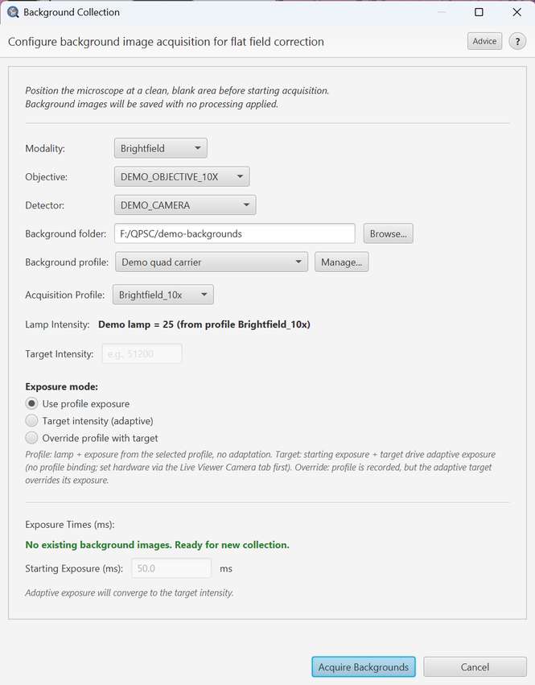

# Background Collection

> Menu: Extensions > QP Scope > Collect Background Images
> [Back to README](../../README.md) | [All Tools](../UTILITIES.md)

## Purpose

Acquire flat-field correction images for improved image quality. Background images correct for uneven illumination, dust on optics, and sensor artifacts. These correction images are essential for producing high-quality stitched acquisitions.

## Prerequisites

- Microscope positioned at a clean, blank area (empty slide or uniform background)
- Connected to microscope server
- A [background profile](background-profiles.md) for the setup on the stage (create one with **Manage...** in this dialog, or in Utilities > Image Quality > Background Profiles...)
- For JAI cameras: Run White Balance Calibration first

## Options

### General Settings

| Option | Type | Default | Description |
|--------|------|---------|-------------|
| Modality | ComboBox | From config | Select imaging modality (e.g., ppm_20x) |
| Objective | ComboBox | From config | Select objective lens. **Objective changes sync across all open dialogs** (Acquisition Wizard, Live Viewer Camera Control, Existing-Image Acquisition, etc.), so selecting a new objective here updates all other open dialogs' selectors automatically. |
| Detector | ComboBox | From profile | Select camera/detector. Choosing an acquisition profile selects the detector that profile names, so on a scope with a camera per modality the background is filed under the right camera. |
| Acquisition Profile | ComboBox | Auto-resolved | (Optional) Acquisition profile whose illumination intensity the server applies during collection. Shown when the modality declares one or more acquisition profiles. The lamp intensity for the selected profile is displayed below. |
| Lamp Intensity | Label | From profile | (Read-only) Illumination intensity applied during collection, sourced from the selected acquisition profile. Visible only when the modality has adjustable illumination. Scopes without a lamp (e.g., PPM) do not show this field. |
| Background folder | Directory Picker | From config | The background base folder (`background_correction.base_folder` in the imageprocessing YAML). Profiles live under `<folder>/profiles/`. |
| Background profile | ComboBox + Manage... | The active profile | **Required.** The [background profile](background-profiles.md) this set is for: the slide carrier or insert, slide source, orientation and mounting medium on the stage now. The combo is the QuPath-wide active profile, so choosing here changes it for the acquisition dialogs too. **Manage...** creates one. Without a profile, Start refuses. |
| Use Per-Channel WB | CheckBox | OFF | Use per-channel white balance calibration (JAI cameras) |
| White Balance Mode | ComboBox | From profile | The WB regime backgrounds will be collected for (Off / Camera AWB / Simple / Per-angle PPM). Drives which set of `background_*.tif` files is written so the right backgrounds are picked up at acquisition time. |

### Background Status Per WB Mode

Below the controls, the dialog shows a live status list of background coverage for each WB mode the active modality supports. Each row is colour-coded:

- **[OK]** -- backgrounds exist and match the active calibration.
- **[STALE]** -- backgrounds exist but the calibration changed since they were collected; re-run for that mode to refresh.
- **[MISSING]** -- no backgrounds for that mode yet.

Use this to verify, before clicking **Acquire Backgrounds**, that you only need to recapture the modes that are actually stale or missing.

### Advice Button

The **Advice** button (top right of the dialog header) opens a short guide tailored to the current modality and detector that walks through clean-area selection, sensible exposure choices, and what failure modes to look out for (saturation, vignetting, lamp drift). Use it whenever the dialog appears for an unfamiliar modality.

### Dialog stays open during acquisition

The dialog now stays open while the **Acquire Backgrounds** run is in progress and refreshes the status list when it finishes, so the operator can immediately see what was just collected, queue another mode, or close. (Previously the dialog closed at the moment of capture, which forced the user to reopen it to verify the result.)

### Exposure mode (Brightfield + PPM on monochrome cameras)

For brightfield and PPM on a **monochrome** camera, the dialog shows a three-radio "Exposure mode:" selector. The three controls in this section (Acquisition Profile, Starting Exposure, Target Intensity) are independent levers, and the mode you pick spells out which one drives the saved background:

| Mode | Lamp + record | Starting exposure | Target intensity | Notes |
|---|---|---|---|---|
| **Use profile exposure** (default for BF) | Profile sets lamp + records the binding | **Read from profile** (field disabled) | **Off** (field disabled) | No adaptive adjustment. The server applies the profile's `illumination_intensity` and uses the profile's declared `exposure_ms`. The simplest, most reproducible mode. |
| **Target intensity (adaptive)** (default for PPM monochrome) | **No profile binding.** Hardware is assumed already set via the Live Viewer Camera tab. | Server seeds the adaptive loop here | Required (positive value) | The server iterates exposure until the median pixel reaches the target. No profile is written into the saved `background_settings.yml`. Acquisition won't tie this background to any profile. |
| **Override profile with target** | Profile sets lamp + records the binding | Server seeds the adaptive loop here | Required (positive value) | Both levers active. The resulting exposure is whatever the adaptive loop converges to, **not** the profile's nominal `exposure_ms`. The saved YAML records `profile.exposure_overridden: true` so downstream code can flag the mismatch. You'll get a confirmation dialog at Start. |

Default picks per modality:

- **Brightfield (monochrome)** -- starts in **Use profile exposure**.
- **PPM (monochrome)** -- starts in **Target intensity (adaptive)** to preserve the existing adaptive behavior PPM relied on before this selector existed.

The selector is **hidden** for:

- **RGB (JAI) cameras**, where target-intensity is not exposed and white-balance mode drives exposure semantics instead.
- **PPM with WB Simple or Per-angle** -- per-angle exposures live in the WB calibration; editing them here would split background and acquisition exposures.
- **Fluorescence / widefield IF** -- per-channel exposures come from the selected profile's channel table; the channel grid in the dialog is read-only and the per-channel lamp/exposure values are authoritative.

Choices persist per modality family (`qpscBgExposureMode.brightfield`, `qpscBgExposureMode.ppm`).

### Angle Configuration (Multi-Angle Modalities)

For multi-angle modalities like PPM, configure each angle:

| Column | Type | Description |
|--------|------|-------------|
| Angle | Label | Polarizer angle in degrees |
| Target Intensity | Spinner | Target grayscale value (e.g., 245 for bright angles, 125 for medium) |
| Initial Exposure | Spinner | Starting exposure time in milliseconds |

### Channel Configuration (Fluorescence Modalities)

For fluorescence profiles (e.g., DAPI, FITC, TRITC), the collection uses a per-channel mode instead of angle-based configuration:

| Column | Type | Description |
|--------|------|-------------|
| Channel | Label | Channel identifier (e.g., DAPI, FITC) |
| Exposure | Label | Default exposure time for the channel (read-only, from profile) |
| Intensity | Label | Illumination intensity for the channel (read-only, from profile) |
| Status | Label | "In use" for channels with positive intensity, "Skipped (unused)" for channels with 0 intensity |

The **unused-channel rule** applies: a channel is collected only if it has a positive illumination intensity. Channels with 0 intensity are skipped, and no background is required for them at acquisition time. This means the number of backgrounds collected depends on how many channels in the profile have non-zero intensity.

### LC-PolScope

For the LC-PolScope modality the dialog shows the five states at their one acquisition exposure (the Exposure column is the same for every state; there is no Intensity column). **Target Intensity is hidden**, because the background must be taken at the acquisition exposure and is never adapted. The background is used for every LC-PolScope acquisition whenever its folder is configured, regardless of the "Use background correction" checkbox. Collect it again after every calibration or exposure change. See the **Backgrounds** item under the LC-PolScope section of [CHANNELS.md](../CHANNELS.md) for the full rules.

## Workflow

1. Position the microscope at a clean, blank area with no tissue or debris
2. Open Collect Background Images from the menu
3. Select the modality, objective, and detector matching your acquisition setup
4. Check the background folder, and choose the **background profile** for the carrier, slides and medium on the stage (create one with **Manage...** if this setup has none yet)
5. (Optional) Select an acquisition profile if the modality has multiple profiles
6. For monochrome BF / PPM, pick an **Exposure mode** (see above). For fluorescence, verify the per-channel table; for RGB BF / PPM, the WB-mode setting drives behavior.
7. If the chosen exposure mode requires it, fill in starting exposure and/or target intensity
8. Click **Start** to begin collection

### For Angle-Based Modalities (PPM, Brightfield)

For each configured angle, behavior depends on the exposure mode:

- **Use profile exposure** -- the server applies the profile's exposure and snaps. No adaptive iteration.
- **Target intensity (adaptive)** -- the server iterates exposure from the starting value until median pixel reaches the target.
- **Override profile with target** -- same as adaptive, but the saved background is tagged to the profile (with `profile.exposure_overridden: true`).

The final background image is saved with metadata; the process repeats for all configured angles.

### For Channel-Based Modalities (Fluorescence)

For each in-use channel in the selected profile:

1. The system configures the channel's exposure and illumination intensity
2. A test image is captured
3. Exposure may be adjusted if adaptive exposure is enabled
4. The final background image is saved as `<channelId>.tif` in a profile-keyed folder
5. The process repeats for all in-use channels (channels with 0 intensity are skipped)

## Output

### Folder structure

Backgrounds are filed by background profile, then hardware: `<base>/profiles/<profile id>/<detector>/<modality>/<mag>/`. Folders directly under `<base>` (the layout from before profiles) are not read; the Background Profiles dialog can move them into a profile. Below the profile folder, the white-balance mode determines whether a further subfolder is added:

- **Monochrome / no white balance (`off`)** -- saved to the **flat** `.../<detector>/<modality>/<mag>/` folder (e.g. `.../profiles/carrier4/HAMAMATSU_DCAM_01/Brightfield/10x/background.tif`). There is **no** `off` subfolder.
- **Colour WB modes (`simple`, `per_angle`, `camera_awb`)** -- saved under a `<wbMode>/` subfolder so the modes coexist.

Collection and acquisition resolve this path through the same helper, so a freshly collected background lands exactly where acquisition reads it. (A prior bug filed monochrome backgrounds in a stray `off/` subfolder while acquisition kept reading the flat path and silently reused a stale background -- fixed; re-collect once to overwrite any stale flat-folder file.)

### Angle-Based Modalities

- One background image per angle, saved to the output folder
- Each image includes metadata recording exposure, gain, and angle settings
- Images are named with the modality, objective, detector, and angle information
- Settings saved to `background_settings.yml` with all angle-exposure pairs
- A `context` block in that file records the setup: the background profile, the Stage Map insert and the open image's slide placement at collection, the stage position, and `collected_at` (which the stale check uses instead of the file date)

### Channel-Based Modalities

- One background image per in-use channel, named `<channelId>.tif`
- Saved in a profile-keyed subfolder (e.g., `.../<detector>/Fluorescence/20x/Fluorescence_20x/`)
- Each channel background records that channel's exposure and illumination intensity
- Settings saved to `background_settings.yml` (v2.0) with per-channel metadata and lamp intensity tracking

## Tips & Troubleshooting

- **Background exposures MUST match acquisition exposures** for proper flat-field correction
- Backgrounds are specific to each objective/detector/modality combination -- collect separately for each
- Backgrounds are also specific to the sample setup: collect a set into a separate [background profile](background-profiles.md) for each carrier, slide source or medium, and make that profile active before acquiring. Acquiring with the wrong profile active gives a warning when the profile declares a different insert or slide placement
- Recollect backgrounds after changing illumination settings or replacing the lamp
- **Lamp intensity tracking** (v2.0): The server records the lamp intensity used during background collection. The Acquisition Wizard will warn if that intensity no longer matches the active profile's setting; re-collect backgrounds to clear the warning
- JAI cameras automatically load per-channel white balance calibration when available (independent of per-channel background collection for fluorescence)
- **Per-channel backgrounds (fluorescence)** are collected only for channels marked as "In use" (positive illumination intensity). Channels with 0 intensity are skipped; no background is required for them at acquisition time
- If images show uneven patterns after correction, the background may be contaminated -- reposition to a cleaner area
- **Repeated tile-grid texture after correction** usually means acquisition is using a *stale* background rather than the one you just collected. The completion notification reports the exact `Saved to:` folder, lamp, and exposure -- confirm that folder matches where acquisition loads from (monochrome backgrounds are the flat `.../<mag>/` folder, not a `.../<mag>/off/` subfolder). Re-collect to overwrite a stale file
- **"No background subtraction for angle(s) X deg" warning** means one or more angles lack a matching background image in the output folder. The acquisition will proceed (the warning is non-blocking), but those angles will not have flat-field correction applied and may show uneven illumination or dust artifacts. To fix this, return to the Background Collection dialog, select the missing angle(s), and run collection again.
- Ensure the blank area is truly uniform -- dust, scratches, or tissue remnants will contaminate the background
- For best results, collect backgrounds at the beginning of each imaging session
- If auto-exposure does not converge to the target intensity, check that the lamp is on and the illumination path is clear

## See Also

- [Camera Control](camera-control.md) - Verify camera settings before collecting backgrounds
- [Live Viewer](live-viewer.md) - Navigate to a clean blank area before collection
- [Bounded Acquisition](bounded-acquisition.md) - Uses background images for flat-field correction
- [Existing Image Acquisition](existing-image-acquisition.md) - Uses background images for flat-field correction
