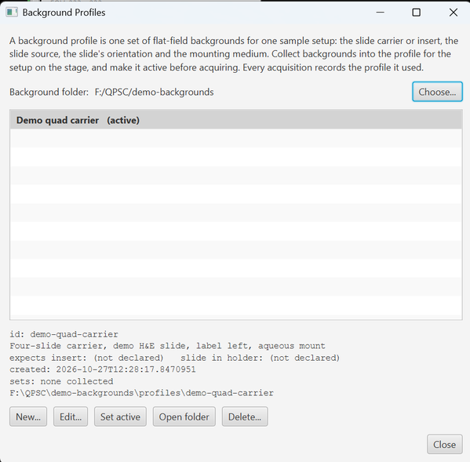

# Background Profiles

> Menu: Extensions > QP Scope > Utilities > Image Quality > Background Profiles...
> [Back to README](../../README.md) | [All Tools](../UTILITIES.md)

## Purpose

A flat-field background depends on more than the optics. The slide carrier or insert puts the slide at a different height in the light path and under different glass; slides from different scanners differ in thickness and mounting; the slide's orientation under the camera and the mounting medium change the gradient in every tile. One background per objective and camera is not enough.

A **background profile** is one complete set of backgrounds for one sample setup. Keep a profile per carrier, slide source or medium, collect backgrounds into each, and make the right one active before acquiring. Every acquisition records which profile it used.

## Where profiles live

```
<background folder>/
  profiles/
    <profile id>/
      profile.yml
      <detector>/<modality>/<magnification>/[<wb mode> | <acquisition profile>]/
```

The background folder is `background_correction.base_folder` in `imageprocessing_<scope>.yml`, one per microscope. Everything below a profile folder is the usual layout (see [Background Collection](background-collection.md)). Folders directly under the background folder, from before profiles existed, are not read; **Adopt old folders...** moves them into a profile.

`profile.yml`:

```yaml
id: carrier4_aperio
name: 4-slide carrier, Aperio slides
description: Slides scanned on the Aperio GT450, 1 mm glass, in the quad carrier.
created: 2026-10-22T09:14:00
expects:                 # optional; checked before an acquisition, warn only
  insert: quad_v         # a stage.inserts id from the microscope YAML
  slide_insertion: B     # A or B: the two ways the slide drops in (a 180); the Stage Map names them by the drawn label side
attributes:              # free text; recorded, never checked
  carrier: quad_v
  slide_source: Aperio GT450
  medium: Permount
```

## The active profile

The active profile is a QuPath-wide preference (`activeBackgroundProfile`), because it describes what is on the stage now, not a project. It appears as a **Background profile** combo in:

- Bounded Acquisition and Existing Image Acquisition, with the background status for the chosen hardware beside it;
- the Acquisition Wizard's hardware section;
- Background Collection, where it is the profile the new set is filed under.

All of them show and set the same value. **(none)** clears it: acquisitions then run without background correction and say so, and Background Collection refuses to start until a profile is chosen.

When you change the **Insert** in the Stage Map and exactly one profile declares that insert, a small window offers to switch to it. It is not modal and never switches on its own.

## The dialog

| Control | What it does |
|---|---|
| Background folder / Choose... | Shows the base folder; Choose... writes it to the imageprocessing YAML. |
| List | Every profile, the active one in bold. The panel below shows its id, description, expected insert and placement, attributes, creation time, how many sets it holds, and its folder. |
| New... | Opens with suggested values from the setup on the stage: **Expected insert** from the Stage Map, **Slide in holder** from the open image (else the scope's default), and a name, id and description built from them, plus `slide_source` when the open image records its scanner. The placement is named by where the label is, as the Stage Map captions it, once the Stage Map has drawn a slide on that insert; until then it reads "placement A" or "placement B" with no side, since which side A is depends on the scanner and the microscope. A line at the top says where each value came from. The name, id and description follow the insert and slide-in-holder choices until you type in them; clearing the id brings the suggestion back. The id (a folder name: letters, digits, `-`, `_`) is checked as you type: a bad character or an id already in use is shown below the form and **OK** stays disabled, so nothing typed is lost. An insert not in this microscope's configuration and attribute lines that are not `key: value` are shown as warnings. **Make this the active background profile** is ticked by default. With no background folder set yet, New... asks for one first. |
| Edit... | The same form, id fixed. |
| Set active | Makes the selected profile the active one. |
| Copy scope-wide white balance | Copies the scope-wide PPM white balance (per-angle and simple, for every objective and camera that has one) into the selected profile, as that profile's own white balance. Use it for an existing profile that has none; white balance the profile already has is kept. See [White Balance Calibration](white-balance-calibration.md#stored-with-the-background-profile). |
| Open folder | Opens the profile folder in the file browser. |
| Delete... | Removes the profile folder and every background in it, after confirmation. |
| Adopt old folders... | Shown only when folders from before profiles exist under the background folder: moves the ticked ones into a profile. |



*The dialog on the demo microscope with one profile active. The lines under the list are the selected profile's record: id, description, what it expects, when it was created, which background sets it holds, and its folder.*

## What is checked, what is recorded

Before an acquisition locks the stage, the usual background check (lamp level, exposure) also compares the active profile's `expects` with the current setup: the insert selected in the Stage Map and the slide's recorded **Slide in holder** setting (the open image's, else its base image's; nothing is compared when none is recorded). A difference is a warning with **Proceed Anyway / Cancel**, never a block, like every other background mismatch. Nothing in `attributes` is checked.

Recorded:

- PPM per-angle and simple white balance are kept per profile, in `white_balance.yml` beside the profile's backgrounds (see [White Balance Calibration](white-balance-calibration.md#stored-with-the-background-profile));
- the acquisition command carries `--bg-profile <id>` beside `--bg-folder`;
- the project entry gets `background_profile`;
- the stitch record's `[acquisition]` section has `background profile:` and `background folder:` lines;
- each `background_settings.yml` has a `context` block with the profile, the insert and slide placement at collection, the stage position and `collected_at`.

## Tips

- Name profiles after what you would say at the microscope: "quad carrier, Aperio", "single slide, Permount".
- Declare the insert and placement when they matter; the warning is the only thing that stops a wrong profile from going unnoticed.
- One profile per run: a multi-slide batch uses the active profile for every slot.
- After a lamp change or a new white balance calibration, every profile is stale. Re-collect the ones you use.

## See Also

- [Background Collection](background-collection.md) - collecting a set into a profile
- [Bounded Acquisition](bounded-acquisition.md) and [Existing Image Acquisition](existing-image-acquisition.md) - where the active profile is chosen for a run
- [Stage Map](stage-map.md) - the insert the profile is checked against

## BaSiC profiles: when there is no background image

A background image is measured from an empty field. A PMT or laser scanner shades its field too, but an empty field reads only the detector's offset, so there is nothing to divide by. A BaSiC profile estimates the shading from tissue tiles instead. It is the alternative to background images for that run, never an addition to them.

**Fit one.** Use **Utilities > Image Quality > Estimate Flat-Field from Tiles (BaSiC)...**. Choose a folder of tiles and where to save the profile; the microscope server does the fit, so it must be able to see the folder. The fit can take a while and the dialog will not start one during an acquisition: wait for the acquisition to finish first.

- For a QPSC acquisition, choose a region's folder: each channel is fitted on its own and saved in a subfolder named for the channel.
- For a MicroManager acquisition, enter the channel number and fit one channel at a time.
- Use raw tiles or averaged frames, never max projections.
- Use at least 40 tiles with tissue in them. With fewer, a fit can come out nearly flat with no error, and the dialog warns you.
- A profile fits one detector, objective, zoom and channel. Fit again if any of those changes.
- Tiles with no empty fields, such as confluent tissue, need the **Measured offset**: the detector's reading with no light. Without it the offset is read from tissue, and the fit is refused if that takes the shading below 0.1 of the mean. A milder error is not caught, so check the result on such a sample.

**Use one.** Set **Flat-field correction** to **BaSiC profile** in the Acquisition Wizard, Bounded Acquisition or Acquire from Existing Image, and choose the profile folder. The line under it says what the folder covers. Each plane is corrected as it is collected, before any Z projection and per channel. A channel with no profile, or a profile of the wrong size, is left uncorrected with a warning in the server log. The Z-Stack / Time-Lapse dialog follows the same choice and says so; it needs a profile covering every image, not one per channel. BF+IF does not offer BaSiC, because its brightfield channel needs its background image and a run uses one method or the other. For MicroManager data, tick **Correct uneven brightness with a flat-field profile** in Tiles to Pyramid.

The correction is `(raw - offset) / flatfield + offset`, so the background keeps its value. It evens out brightness but does not improve signal to noise: the dim corners carry more noise afterwards. Live View, autofocus and saturation checks all use the uncorrected frames.

